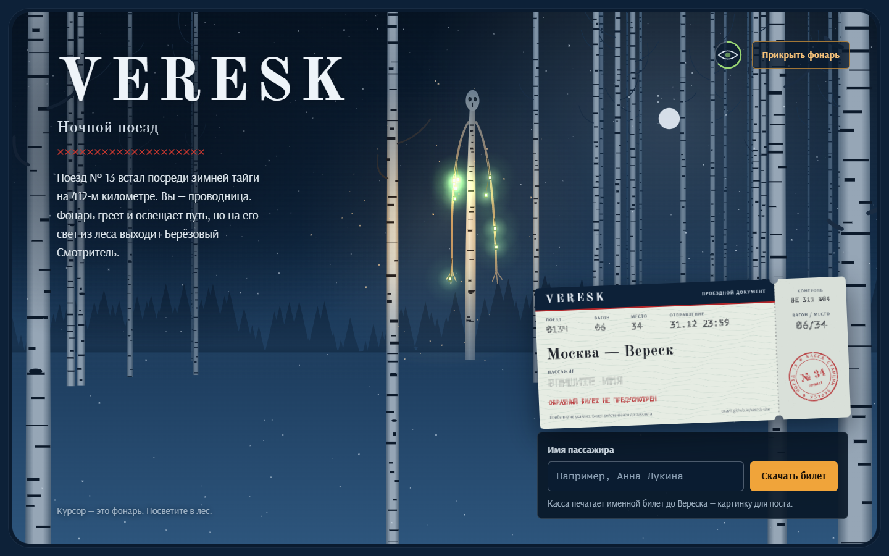

# VERESK — промо-сайт игры

Одностраничный сайт фолк-хоррора VERESK, концепта игры для учебного проекта. Ночной поезд встал посреди зимней тайги,
а на свет фонаря из леса выходит Берёзовый Смотритель.

**Сайт:** https://ocavit.github.io/veresk-site/

**Целевое действие** — скачать именной билет на поезд до Вереска: PNG 1200×630 для поста.



## Документы

| Файл | Что внутри |
|---|---|
| [TZ.md](TZ.md) | Техническое задание: цель сайта, аудитория, целевое действие, разделы, дизайн, десктопная и мобильная версии, бэклог, критерии приёмки |
| [AGENTS.md](AGENTS.md) | Правила для ИИ-агента и журнал работы маленькими шагами со ссылками на коммиты |
| [Reflex.md](Reflex.md) | Рефлексия: где агент ошибся, как заметили, причина, исправление, правило на будущее |
| [.claude/skills/](.claude/skills/) | Дизайн-скиллы, по которым сделан сайт: impeccable и frontend-design (Apache 2.0) |
| [process/screenshots/](process/screenshots/) | Скриншоты проверок по шагам: до и после исправлений, состояния формы, готовый билет |

## Устройство

- `docs/` — сам сайт, его раздаёт GitHub Pages:
  - `index.html`;
  - `assets/style.css`;
  - `assets/night.js` — сцена за окном и фонарь;
  - `assets/ticket.js` — касса и билет.
- `tools/shot.py` — скриншоты десктопа (1440×900) и телефона (390×844).
- `tools/check_ticket.py` — проверка формы и скачивания билета.

Чтобы посмотреть сайт локально:

```
python -m http.server 8000 -d docs
```

Затем откройте http://localhost:8000/
